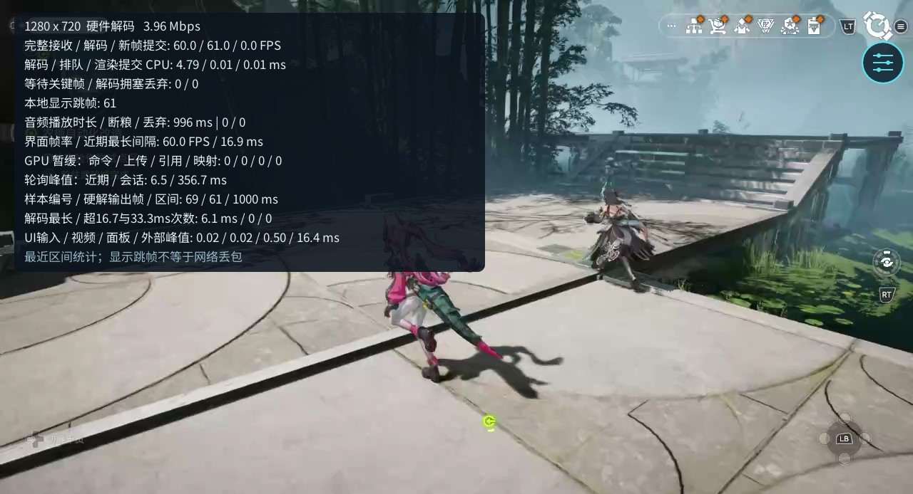

# 圆石启动器 · Switch 多合一云游戏启动器

**用 Joy-Con 在 Switch 上直接玩云游戏，一个 NRO 集中管理多个游戏入口。**

**已发布 0.2.111 alpha：** [完整安装包（推荐）](https://github.com/Steve1451-dot/yuanshi-launcher-ns/releases/download/v0.2.111/yuanshi-launcher-0.2.111.zip)
· [仅 NRO](https://github.com/Steve1451-dot/yuanshi-launcher-ns/releases/download/v0.2.111/yuanshi-launcher-0.2.111.nro)
· [发布说明与校验文件](https://github.com/Steve1451-dot/yuanshi-launcher-ns/releases/tag/v0.2.111)

`圆石启动器` 是面向可运行自制程序的 Switch 大气层环境的非官方开源云游戏客户端，
将 **ys / zmd / bt** 集中到同一个启动器。使用自己的官方云服务账号登录，Switch 直接
接收对应云服务器的画面和声音，并通过 Joy-Con、手柄或触屏操作，**不需要另开电脑转发**。
目前 ys / zmd 已通过 Switch 实机测试，可正常游玩；bt 仍在适配中。

**无需安装或进入安卓系统，直接在 Switch 本身的系统（大气层自制程序环境）中运行。**
通过 hbmenu / sphaira 启动 NRO 即可使用；未配置自制程序环境的 Switch 不能直接运行本项目。

客户端使用 C++20、libnx、WebRTC 与 Deko3D 原生开发，不是在 Switch 上安装 Android APK，
也不是把游戏本体移植到 Switch，或连接自己 Windows 电脑的远程桌面软件。

项目沿用并改进 [OpenNOW-Switch](https://github.com/OpenCloudGaming/OpenNOW-Switch)
及其 SwitchNOW 上游的基础设施，与任天堂、米哈游、鹰角、NVIDIA 等公司无隶属、
授权背书或赞助关系。**本项目仅供学习、研究和技术参考**，不提供游戏资源、账号、
付费权益或云服务器，不替代官方服务。请仅使用有权使用的账号及服务，并遵守服务条款。

[效果展示](#效果展示) · [项目意义](#项目意义) · [游戏支持与进度](#游戏支持与进度)
· [特色功能](#特色功能) · [安装使用](#安装使用)
· [按键操作](#按键操作) · [功能与验证状态](#功能与验证状态)
· [当前限制](#当前限制) · [源码构建](#源码构建) · [许可与致谢](#许可)

> 当前源码为 **0.2.112 alpha**，加入原神原生手柄直通，尚待 Switch 实机验证游戏内键位保存。
> 上方下载链接仍为已发布的 0.2.111；bt 仍在适配中。
> 三款游戏共用启动器、登录管理、串流设置与本地手柄配置，软件内简称统一为 **ys / zmd / bt**。

## 效果展示

### 原神（ys）


ys（原神）串流效果：游戏画面、手柄按键提示、右上角触屏悬浮球与右下角网络延迟。

### 终末地（zmd）



zmd（终末地）串流效果：游戏画面、实时诊断面板与右上角触屏悬浮球。

图中数据仅代表截图时的会话状态。

## 项目意义

我们希望让已有 Switch 的玩家，多一种利用现有设备游玩云游戏的方式：

- **在 Switch 本身系统中玩云游戏**：不需要切换到安卓系统。游戏在对应云服务器上运行，
  Switch 接收画面和声音、发送操作；不需要自备游戏电脑，也不需要经过电脑二次串流。
- **围绕掌机操作做适配**：使用机身两侧的 Joy-Con 或其他手柄游玩，提供触屏悬浮球、
  可视化本地改键，以及原神的体感辅助瞄准，让操作和设置更适合 Switch。
- **多个游戏，一套使用习惯**：在同一个客户端切换游戏入口，统一调整画质与目标帧率，
  每款游戏独立保存登录、串流偏好和键位，不必来回设置。
- **把实现开放给社区**：公开原生客户端的登录对接、媒体接收、输入映射和诊断代码，
  供学习、研究与共同改进，持续优化 Switch 上的使用体验。

本项目提供的是**连接现有官方云服务的客户端**，不是模拟器、离线版游戏或免费云游戏服务。
账号资格、可用时长、排队和付费权益仍由对应官方服务决定；使用前需要自己的有效账号和网络。

## 游戏支持与进度

| 软件内简称 | 对应游戏 | 当前进度 | 测试结果与支持情况 |
| --- | --- | --- | --- |
| **ys** | 原神 | **100%** | **Switch 实机测试通过，可正常游玩。** 支持本地改键和体感辅助 |
| **zmd** | 明日方舟：终末地 | **100%** | **Switch 实机测试通过，可正常游玩。** 支持本地改键与悬浮球设置 |
| **bt** | 崩坏：星穹铁道 | **开发中** | 登录保存、恢复、续期及开场画面已测试；仍会出现 `1001_2`，暂时无法正常进入游戏 |

100% 表示当前计划功能已完成。实机测试结果对应已测试的设备和网络环境，
实际体验仍会受到网络质量及官方服务状态影响。

## 特色功能

- **原神体感辅助瞄准**：支持 Joy-Con 六轴；开启本地辅助后，按住实体 **ZL** 转动
  手柄，将体感数据映射为右摇杆输入。不需要在云端保存体感配置，也不等同于游戏原生六轴支持。
- **可视化自定义键位**：在悬浮球设置中查看手柄图并修改本地映射，按游戏独立保存到 SD 卡。
  重启后自动读取；在同一安装目录更新程序并保留配置文件时无需重新设置，不改变云端游戏内键位。
- **触屏悬浮球与画质 / 帧率调整**：串流中点击悬浮球打开设置，拖动可改变位置，
  不占用 L+R。可选择串流画质档位和目标帧率；新配置默认最低串流档 / **60 FPS**，
  实际输出以服务端支持和网络条件为准。
- **透明网络延迟与诊断**：右下角常驻显示连接 RTT，例如 `15 ms`；需要时打开透明诊断文字，
  查看接收、解码、渲染和丢帧等数据。自动安全日志与轮转记录便于排查，不包含登录凭据。

## 功能与验证状态

当前源码包含：

- **多合一入口**：同一程序选择 ys、zmd、bt，共用启动器和操作风格，保留各自的登录、
  串流偏好与手柄映射；不是三个独立 NRO，也不要求安装三个 APK。
- **登录与启动**：官方扫码授权、加密保存登录、本地会话恢复、节点选择与普通排队；
  登录失效或需要官方验证时仍须本人确认，不保证永久免扫码。
- **画面与声音**：H.264 视频接收、Opus 音频管线、NVDEC 初始化及软件解码回退；
  硬解是否启用、实际帧率与声音输出以设备和会话诊断为准。
- **操作与配置**：Xbox 兼容的虚拟手柄输入、触屏、可视化本地改键、每游戏独立保存；
  ys 包含按住实体 ZL 的本地体感转右摇杆辅助，不等同于云端原生六轴支持。
- **串流界面**：触屏悬浮球、画质及帧率请求、透明诊断文字、右下角网络往返延迟。
- **持久化与诊断**：中英文切换、自定义背景、自动安全日志、总量约 8 MiB 的轮转历史。
  普通日志只记录固定事件和数值，不输出令牌、Cookie、二维码内容或完整协议负载。

| 项目 | 当前状态与边界 |
| --- | --- |
| 右下角延迟 | 每秒读取连接已有的平滑 ICE/SCTP RTT；不可用时显示 `-- ms`，不是输入到显示的总延迟 |
| 本轮自动检查 | 延迟取值与透明绘制、日志新旧格式兼容、SDK/会话和界面策略测试；具体构建结果见随包校验记录 |
| 实机性能 | 不承诺所有机型、网络都稳定满帧；没有用 yuzu 性能代替 Switch 性能结论 |

新配置默认请求 **最低串流档 / 60 FPS**；后续明确保存的配置优先。
这是向服务端发送的请求，不保证固定输出码率或服务端游戏内画质。
程序不会自动超频；硬解不可用时可能回退软解，不能仅凭设备型号认定已启用硬解。

## 安装使用

准备可运行自制程序的 Switch、可用网络、本人官方云服务账号及用于确认登录的手机。

1. 从 [Releases](https://github.com/Steve1451-dot/yuanshi-launcher-ns/releases/tag/v0.2.111)
   下载 `yuanshi-launcher-0.2.111.zip`，或按下文自行构建。
   **上游 OpenNOW 的 GeForce NOW 安装包不是本客户端。**
2. 将压缩包的 `switch` 文件夹合并到 SD 卡根目录，新目录为 `switch/yuanshi-launcher/`。
3. 使用完整应用模式进入 hbmenu / sphaira，例如按住 R 启动一个游戏进入 hbmenu，
   再打开本启动器。不建议以相册小程序模式测试内存和性能。
4. 选择 ys、zmd 或 bt，按提示用官方手机 App 扫码并确认。已有有效登录会尝试恢复。
5. 点击开始，等待官方服务完成节点选择、普通排队及派发。遇到验证、协议确认或维护提示，
   请按页面说明处理；不要把“已登录”理解为游戏连接已完成。

Releases 中的 `Source code` 压缩包是源码，不包含已编译的 NRO。
已有本版安装目录时，也可以仅下载 NRO，将其重命名为 `yuanshi-launcher.nro`，替换程序文件并保留配置。

```text
SD 卡根目录/
└── switch/
    └── yuanshi-launcher/
        └── yuanshi-launcher.nro
```

GitHub 仓库名中的 `ns` 用于标明 Switch 平台；本次仓库改名不改变上述程序文件名和 SD 数据目录。
已使用该目录的用户不需要因为仓库改名移动配置或重新登录。

**0.2.111 起使用独立新目录，不兼容旧安装目录。** 程序与数据仅使用
`sdmc:/switch/yuanshi-launcher/`，不会查找、迁移或导入旧目录。第一次使用本版需
重新登录，原来的本地映射、画质和背景不会自动继承。之后同一新目录内更新可保留配置。
程序不会自动删除旧目录。`.key` / `.vault` 是私密登录材料，不要上传或公开分享。

安装包不包含账号凭据、APK、自动排队标记或设备信息发送同意标记。
额外设备信息请求默认关闭，不因普通诊断开关自动获得同意。

## 按键操作

| 场景 | 操作 | 行为 |
| --- | --- | --- |
| 首页 | 方向键 / A / B 或触屏 | 选择、确认、返回 |
| 首页 | ＋ | 退出应用 |
| 串流 | 点击 / 拖动悬浮球 | 打开设置 / 移动悬浮球，不要求 L+R |
| 串流 | − | 传给游戏的 Back / 地图键，不再被诊断占用 |
| 串流 | 按住 L3＋R3 | 打开 / 关闭诊断 |
| 串流 | 同时按住 ＋和− | 停止串流并返回 |
| ys | 游戏原生手柄（默认） | 标准手柄直通，键位在游戏内设置；停用本地战斗重排和体感转摇杆 |
| ys 设置 | 手柄设置 → 体感与操作模式 | 可切回本地映射；操作模式保存在 SD，下次进入继续使用 |
| 本地映射模式 | 可视化手柄映射 / 实体 ZL 体感辅助 | 按游戏保存本地配置；不修改云端游戏内键位 |

原生模式的动作绑定以游戏内设置为准，跨云端实例保留仍待验证。
本地映射模式以悬浮球中的可视化配置为准。打开本地菜单时会抑制并释放游戏输入，
以免菜单操作同时误触游戏。

## 背景与诊断

自定义背景放在 `sdmc:/switch/yuanshi-launcher/backgrounds/`，各入口对应文件名为
`genshin.png`、`endfield.png`、`starrail.png`，也可使用 `.jpg` / `.jpeg`。
请自行确认图片使用权限；没有可用文件时使用程序原创几何背景，不需要另装图包。

遇到卡顿、黑屏或退出，可提供 `cloudgenshin-safe.log`、`cloudgenshin-safe-zh.log`
及 `stream-logs/` 下的安全日志。保留故障时的版本与画面信息，有助于区分网络缺包、
等待关键帧、解码拥塞和本地显示跳帧；这些情况不能只凭一个 FPS 数字归因。
不要提供登录库、密钥、二维码或账号令牌。

## 当前限制

- bt 的 `1001_2` 仍在排查，暂时无法正常进入游戏。
- ys / zmd 已通过实机测试；长期运行和弱网环境仍需持续测试，不保证所有设备、网络都表现相同。
- 硬解具有初始化失败回退路径；实际硬解出图和持续性能需在真实 Switch 上确认。
- 远程服务决定排队、维护、资格、验证及画质；本客户端不会绕过这些限制。
- 右下角 RTT 是连接已有的平滑估计，不是持续独立测速，也不等于操作到画面的端到端延迟。
- 缩写只是界面名称，不改变协议标识、资源权属、服务条款或第三方许可证要求。

## 源码构建

需要 devkitPro、devkitA64、Switch portlibs、CMake、Ninja，以及 `extern/` 中固定的依赖。
已配置 MSYS2 / devkitPro 的 Windows PowerShell：

```powershell
.\build-switch.ps1
```

或在 devkitPro MSYS2 中执行：

```bash
bash scripts/build-switch-msys2.sh
```

统一产物为：

```text
build/switch/yuanshi-launcher.nro
```

默认启用原生客户端；统一构建包含 NVDEC 与软解回退，不需要另一套“硬解版”安装包。
生成使用新名称、新目录结构的本地分发包：

```powershell
.\scripts\package-release.ps1
```

已配置交叉编译环境的 Linux / CI 可使用对应入口：

```bash
bash scripts/package-release.sh 0.2.112
```

打包脚本不应覆盖已有同名版本；新版本和原有历史包分开保留。编译完成不等于远程服务互通，
更不等于实机性能验收。实际发布以维护者提供的文件及 SHA-256 校验为准。

## 代码与文档

```text
.
├── app/src/                 启动器、登录、串流、输入与界面
├── app/shortcut/            继承的快捷启动组件
├── resources/               字体、翻译、图标与 RomFS 资源
├── extern/                  固定版本的第三方依赖
├── tests/                   主机侧策略与解析测试
├── scripts/                 构建、打包与安全诊断脚本
└── tools/
    └── opennow-forwarder-installer/
                             继承的 HOME 快捷启动安装器
```

开发检查先运行变更相关的最小主机测试，再执行 Switch 交叉编译。例如已配置 MinGW 的 Windows：

```powershell
.\scripts\test-mihoyo-host.ps1 -TestNames network_latency,network_latency_draw,mihoyo_ui_language
.\tests\cloudgenshin_monitor_test.ps1
```

策略测试使用合成数据，不包含用户凭据；不能测出实机帧耗时或证明真实账号能进入游戏。
历史排障记录位于 `docs/`，其中旧版本的按键、实验路线或已删除游戏不代表当前默认行为。
源码候选版见 [0.2.112 变更与验证记录](docs/yuanshi-launcher-0.2.112.md)。
已发布版见 [0.2.111 变更与验证记录](docs/yuanshi-launcher-0.2.111.md)。

## 许可

本仓库保留上游的 [MIT License](LICENSE) 与版权声明，第三方组件继续遵循各自许可证。
重命名不抹去上游来源，也不将第三方内容重新许可。

## 致谢与参考（References）

本项目由 [Steve1451-dot](https://github.com/Steve1451-dot) 维护。
感谢以下基础项目、参考资料与开源组件的作者；本仓库的提交历史整理不改变上游代码的版权与许可。

- [OpenNOW-Switch / OpenCloudGaming](https://github.com/OpenCloudGaming/OpenNOW-Switch)：
  本项目的直接基础，沿用并改进其 Switch 原生串流、渲染、输入与应用框架。
- [SwitchNOW / Blade-Punisher](https://github.com/Blade-Punisher/SwitchNOW)：
  OpenNOW-Switch 的上游项目，提供早期 Switch 云游戏客户端实现。
- [OpenNOW 文档](https://opennow.zortos.me)：上游项目的使用与技术参考。

核心依赖包括
[Borealis](https://github.com/xfangfang/borealis),
[libpeer](https://github.com/sepfy/libpeer),
[FFmpeg](https://github.com/FFmpeg/FFmpeg),
[libnx](https://github.com/switchbrew/libnx),
[deko3d](https://github.com/devkitPro/deko3d),
[curl](https://github.com/curl/curl),
[Jansson](https://github.com/akheron/jansson) 和
[zlib](https://github.com/madler/zlib).

对应许可证与署名文件保留在各依赖目录中；分发时也应保留适用的许可证和声明。
